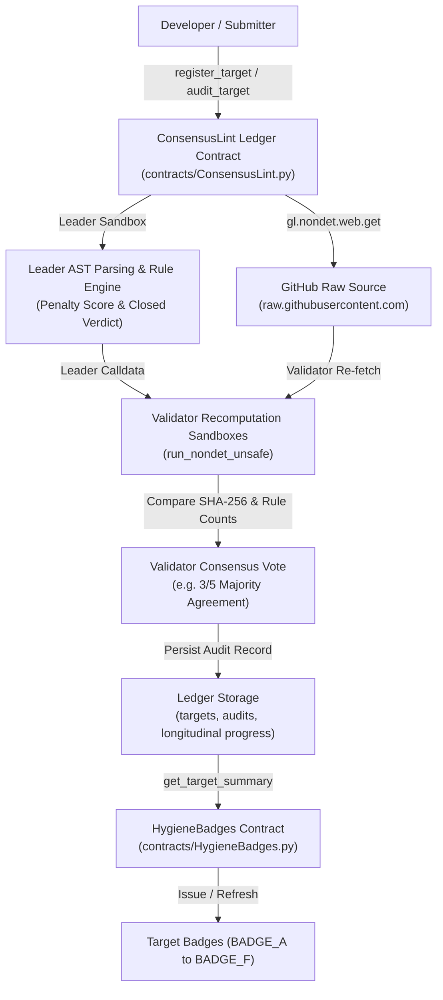

# ConsensusLint

**Validator-Verified Consensus-Hygiene Linter for GenLayer Intelligent Contracts on GenLayer Studionet (Preview)**

ConsensusLint is a decentralized, validator-verified static analysis engine and ledger contract for GenLayer Intelligent Contracts. It inspects pinned Python contract source code against a codified 18-rule consensus-hygiene catalogue, calculates an objective hygiene score and grade, persists revision history on-chain, and composes with a companion badges contract via cross-contract view calls.

> [!IMPORTANT]
> **Scope & Honest Limitations**: ConsensusLint is a static linter over a pinned rule catalogue for one SDK version (`py-genlayer:1jb45aa8ynh2a9c9xn3b7qqh8sm5q93hwfp7jqmwsfhh8jpz09h6`). It is **not** a security audit and cannot prove that an Intelligent Contract is correct, bug-free, or free of risk patterns. Every output carries this statement.

---

## 1. Problem Statement: Why Consensus Fails on GenVM

GenLayer introduces Intelligent Contracts: contracts written in Python that can fetch web data and execute LLM prompts under non-deterministic consensus rules. However, builders repeatedly make the same consensus-hygiene mistakes:
1. **Whole-Payload `strict_eq`**: Using `gl.eq_principle.strict_eq` on model outputs or dynamic JSON payloads produces `NO_MAJORITY` consensus failure because LLMs and serialization order exhibit minor non-deterministic phrasing differences across validators.
2. **Leader Trust Violations**: Validators waving through unverified leader calldata or returning `True` unconditionally.
3. **Unchecked Exceptions in Validators**: Catching errors with `except Exception: return True`, allowing invalid state transitions to be accepted.
4. **`TreeMap` Assignment in `__init__`**: Directly overwriting `self.records = {}` inside `__init__`, bypassing GenVM lazy metadata persistence.
5. **Wall-Clock Time Divergence**: Calling `datetime.now()` or `time.time()` instead of the deterministic chain clock `gl.message_raw["datetime"]`.
6. **Insecure URL Filtering**: Validating source or webhook URLs using `.startswith()` or substring containment without full URL parsing.

Traditional Python linters (flake8, pylint) have no awareness of GenVM runtime semantics, leader-validator roles, or consensus wrappers. ConsensusLint solves this by deploying the rule engine directly to **GenLayer Studionet (Preview)**, where validators fetch the contract source, parse the Abstract Syntax Tree (AST), evaluate consensus hygiene, and vote on closed-enumeration verdicts.

---

## 2. Architecture & How It Works



### Consensus-Safe Mechanics
- **Independent Validator Recomputation**: Validators never trust the leader's findings or line quotes. Every validator independently re-fetches the source inside `gl.vm.spawn_sandbox`, checks the source SHA-256, and re-executes the AST engine.
- **Closed-Enumeration Verdicts**: Consensus is reached over `source_sha256`, target `mode` (`CONTRACT` vs `NOT_A_CONTRACT`), rule violation counts, and a discrete penalty bucket (`penalty // 5 * 5`). Free-text findings are committed only after the closed-enumeration verdict is accepted by validators.
- **Bounded Model Layer**: LLM prompts are limited to at most 3 call sites, clipped to 80 lines each, and require verbatim quote verification in GenVM code before any penalty is applied.

---

## 3. Deployed Contract Addresses

Deployed and active on **GenLayer Studionet (Preview)** (Chain ID `61999`, RPC `https://studio.genlayer.com/api`):

| Contract | Address | Status | Source SHA-256 |
|---|---|---|---|
| **ConsensusLint** | `0xE2cBaf1916Df7C742486B2eC4E5d3A3289115F2D` | Active | `04337cfc91fe45f76042dba860adf4d9f1567e68fabb525838fa7dffaf4d313b` |
| **HygieneBadges** | `0x3CA9E1b7804b442eaA932ae190d494D4A59295bF` | Active | `64181bc3a3965e9427039a8dec504f0c25aeb4e7e9186b54ba426aadb5bb48b8` |
| **Probe (superseded diagnostic)** | `0xCAF2c7cdBD0a6EB4154b763c9fA869407CcCb7b6` | Superseded Diagnostic | `35de2f50206bac0addafb711623795519d8f67efd631e0388b49e9b8c425989b` |

---

## 4. Rule Catalogue (CL01 - CL18)

| Rule ID | Severity | Method | Description |
|---|---|---|---|
| `CL01` | MINOR (3 pts) | STRUCTURAL | Missing or invalid version header (`# v0.2.<n>`). |
| `CL02` | MAJOR (8 pts) | STRUCTURAL | Missing or invalid `py-genlayer` dependency pin. |
| `CL03` | MINOR (3 pts) | STRUCTURAL | Non-ASCII characters present in contract source. |
| `CL04` | INFO (0 pts) | STRUCTURAL | File does not define a class deriving from `gl.Contract` (Grade F). |
| `CL05` | MAJOR (8 pts) | STRUCTURAL | Assignment into `TreeMap` attribute inside `__init__`. |
| `CL06` | MINOR (3 pts) | HEURISTIC | Unbounded list load-append-store pattern in public write method. |
| `CL07` | MAJOR (8 pts) | HEURISTIC | `strict_eq` called on dynamic payload or free-text. |
| `CL08` | MAJOR (8 pts) | STRUCTURAL | Non-deterministic call (`gl.nondet.*`) outside consensus wrapper. |
| `CL09` | CRITICAL (20 pts) | STRUCTURAL | Validator does not recompute verdict or unconditionally returns `True`. |
| `CL10` | MAJOR (8 pts) | STRUCTURAL | Validator accesses leader calldata without `gl.vm.Return` verification. |
| `CL11` | MAJOR (8 pts) | STRUCTURAL | Validator waves through failures in `except` handler (`return True`). |
| `CL12` | MAJOR (8 pts) | HEURISTIC | Silent default fallback on model parse failure inside `try-except`. |
| `CL13` | MAJOR (8 pts) | STRUCTURAL | Wall-clock time call used (`datetime.now()`) instead of chain clock. |
| `CL14` | MINOR (3 pts) | STRUCTURAL | Generic `raise Exception` or `assert` used instead of `gl.vm.UserError`. |
| `CL15` | MAJOR (8 pts) | HEURISTIC | URL validation by substring or prefix check without `urllib.parse`. |
| `CL16` | MINOR (3 pts) | HEURISTIC | Unbounded string parameter in public write method without `len()` check. |
| `CL17` | MINOR (3 pts) | HEURISTIC | Unpaginated view method iterating state collection without `limit`. |
| `CL18` | INFO (0 pts) | HEURISTIC | Public parameter inserted into prompt template without sanitization. |

See [`docs/RULES.md`](docs/RULES.md) for full rationale, bad snippets, and good snippets.

---

## 5. Scoring & Grades

The hygiene score begins at 100 and applies deducted weights per rule with per-rule severity caps:
- **Grade A**: 90 - 100 (High consensus hygiene)
- **Grade B**: 80 - 89 (Good hygiene; minor items or truncation cap)
- **Grade C**: 70 - 79 (Moderate hygiene; multiple minor or major findings)
- **Grade D**: 60 - 69 (Fair hygiene; contains anti-patterns)
- **Grade F**: 0 - 59 (Failed structural requirements or `NOT_A_CONTRACT`)

Dogfooding result:
- `ConsensusLint.py` (66,505 bytes > `MAX_SOURCE_BYTES` 60,000) was linted on-chain up to byte 60,000; it scored **94**, with grade capped at **Grade B** due to truncation. The remaining tail (lines 1287-1438, 6,505 bytes), containing view methods, was not linted on-chain and was verified locally with `scripts/tools/lint_tail.py` as a **LOCAL** run (**100**, Grade A, 0 findings).
- `HygieneBadges.py` (10,951 bytes) was fully linted on-chain and scored **Grade A (100)** with 0 findings.

---

## 6. Known Limitations

1. **Static Linter, Not a Security Audit**: ConsensusLint inspects code patterns against an 18-rule catalogue for a specific pinned GenLayer SDK version (`py-genlayer:1jb45aa8ynh2a9c9xn3b7qqh8sm5q93hwfp7jqmwsfhh8jpz09h6`). It cannot prove that a contract is secure, bug-free, or mathematically correct.
2. **Heuristic Rule Imperfections**: Rules CL06, CL07, CL12, and CL15-CL18 use AST and regex heuristics which may produce false positives or false negatives on complex or non-idiomatic Python constructs.
3. **Model Layer Bounded Penalties & Observed False Positives**: The model layer can lower a score by up to 20 points (`MODEL_PENALTY_CAP`). On-chain observations:
   - **GoodContract Fixture**: Lost 6 points on question J2 (`FREE_TEXT_OR_PAYLOAD`) for the line `return val_sand.calldata == ldata.get("sha256")`, a model false positive on a deterministic SHA-256 digest comparison (score 94 instead of 100).
   - **ConsensusLint Self-Lint**: Lost 4 points on question J3 (`NOT_ISOLATED`) citing `def prompt_call(): return gl.nondet.exec_prompt(prompt_text)`, which quoted the call site rather than prompt template assembly.
4. **Source Code Truncation**: Files exceeding `MAX_SOURCE_BYTES` (60,000 bytes) are linted only up to the last complete line within the first 60,000 bytes. The grade is capped at **Grade B**, while the score is NOT capped (`_compute_score_and_penalty`). The stored `source_sha256` represents the hash of the truncated text:
   - **ShellLike Large Fixture** (196,016 bytes): Score 100 on the first 30% of bytes; capped at Grade B.
   - **ConsensusLint.py** (66,505 bytes): Truncated at line 1286; tail view methods unlinted on-chain.
5. **Leaderboard & Badges Truncation Behaviour**:
   - `ConsensusLint.get_board("best")` ranks by score and does not exclude truncated audits (ShellLike ranks #1 with score 100).
   - `HygieneBadges` does not inspect the `truncated` flag from the ledger summary; a `BADGE_B` for ConsensusLint was issued from a truncated audit.
6. **Mutable References**: While `PINNED_COMMIT` refs guarantee immutable source targets, mutable refs (`main` branch) can change between registration and audit time.
7. **URL & Host Policy**: Only `https://raw.githubusercontent.com/<owner>/<repo>/<ref>/<path>.py` is accepted by `ConsensusLint.register_target`.
8. **Consensus Majority**: Consensus on Studionet is typically majority (3 of 5 validators). Non-deterministic or high-latency operations can produce `UNDETERMINED` (`MAJORITY_DISAGREE`) consensus outcomes, as observed on CitationWatch v1.2.0 audit attempt 1.

---

## 7. Evidence Boundaries: Observed On-Chain vs Unit-Tested Only

### Observed on-chain on active deployment (`0xE2cBaf...` & `0x3CA9E1...`):
- Contract deployments (ConsensusLint, HygieneBadges, set_ledger)
- Positive fixture audits (GoodContract, BadContract, MixedContract, NotAContract, ShellLike)
- Dogfooding self-lints (ConsensusLint truncated, HygieneBadges complete)
- Longitudinal progress tracking (EvolvingContract v1 to v2, get_progress)
- Maintainer response flow (5-argument `respond_to_finding`, verified non-empty stored responses array)
- HygieneBadges issuance & cross-contract queries (`claim_badge`, `get_badge`)
- Decoded negative reverts (`NEG-01` to `NEG-07`, verbatim UserError literals and raw base64 leader bytes)
- Real-world historical audits on-chain (CitationWatch v1.0.0, v1.1.0, v1.2.0, CommitmentLedger v3.1.0)
- Observed validator disagreement (CitationWatch v1.2.0 attempt 1: `status: UNDETERMINED`, `result_name: MAJORITY_DISAGREE`, agreement 2/5)
- Public ledger aggregations (`get_board`, `get_rule_stats`, `list_target_ids`, `list_series`)

### Unit-tested only (until proven on-chain):
- Response count limit rejection (`MAX_RESPONSES_PER_AUDIT = 10`)
- Model layer prompt injection resilience and fallback downgrade
- Disagreement paths in fallback regex scanner
- Pagination bounds > 50 rejection

---

## 8. Quickstart & How to Run

### Requirements
- Node.js v18+ with `genlayer-js`
- Python 3.10+
- Access to GenLayer Studionet (Preview)

### Run Unit & Consensus Tests
```bash
python -m unittest discover tests
```

### Run Safety Scans
```bash
python scripts/tools/scan_ascii.py
python scripts/tools/scan_banned_words.py
```

### Run Empirical Calibration
```bash
python scripts/tools/calibrate.py
```

### Verify Deployment & Evidence Consistency
```bash
node scripts/tools/check_evidence_consistency.js
node scripts/tools/render_evidence.js
```

---

## 7. Documentation Index

- [`docs/DESIGN.md`](docs/DESIGN.md): System architecture, AST vs fallback scanner, consensus-safety principles, threat model.
- [`docs/RULES.md`](docs/RULES.md): Complete catalogue of CL01-CL18 with examples.
- [`docs/PROBES.md`](docs/PROBES.md): Phase 0 runtime probe measurements on Studionet.
- [`docs/CALIBRATION.md`](docs/CALIBRATION.md): Fixture precision/recall, historical timeline, manual review, model calibration.
- [`docs/EVIDENCE.md`](docs/EVIDENCE.md): Complete on-chain evidence with full transaction hashes and validator agreements.
